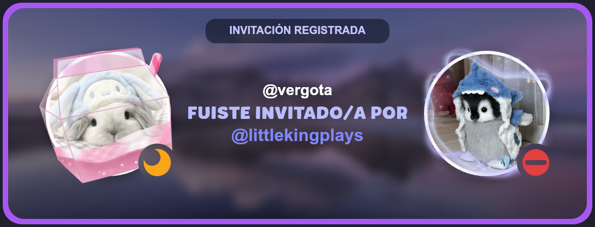

# DISCORD-ARTS · Discord Invite Card

> 🇪🇸 [Leer en español](./README.md)

An invite card image (PNG) generator built with Node.js and [`@napi-rs/canvas`](https://github.com/Brooooooklyn/canvas). It shows the invited user and the person who invited them, each with their avatar, avatar decoration and status indicator, over a custom blurred background.

## Preview




## Features

- Circular avatars with border and shadow.
- A different avatar decoration for each user (`discord-arts` style).
- Status indicator (`online`, `dnd`, etc.) with a transparent gap around it, just like Discord.
- Custom background with blur and a dark overlay so the text stays readable.
- Custom font for the "FUISTE INVITADO POR" ("INVITED BY") text.
- Everything is configurable through constants at the top of the file.

## Requirements

- [Node.js](https://nodejs.org/) 18 or higher
- npm

## Installation

```bash
git clone https://github.com/LittleKingPlaysHN/discord-arts.git
cd discord-arts
npm install @napi-rs/canvas
```

## Folder structure

```
.
├── discord-arts.js            # Main script
├── imagenes/
│   ├── fondo.png       # Custom background
│   ├── deco.webp       # Invited user's decoration
│   ├── deco2.webp      # Inviter's decoration
│   ├── online.png      # Status icons
│   ├── dnd.png
│   ├── idle.png
│   └── offline.png
├── fuentes/
│   └── fuente.otf      # Font for "FUISTE INVITADO POR"
└── README.md
```

> The status icon file names must match the `status` value you pass to the function (`online`, `dnd`, `idle`, `offline`, etc.).

## Usage

```bash
node discord-arts.js
```

This generates an `invite.png` file in the same folder as the script.

## Credits

- **Visual style:** inspired by [**discord-arts**](https://www.npmjs.com/package/discord-arts), the npm package for generating Discord profile images, especially its use of avatar decorations and the gap around the status indicator. This repository does not include or use its code; it is an independent implementation.
- **Image drawing:** [`@napi-rs/canvas`](https://github.com/Brooooooklyn/canvas).
- **Fonts:** downloaded from [DaFont](https://www.dafont.com/es/green-matcha.font).
- **Avatar decorations:** obtained from [Discord Decoration Art](https://discord-decoration.art/).

All rights to the fonts, decorations and other resources belong to their respective authors.

Also used:

- [`@napi-rs/canvas`](https://github.com/Brooooooklyn/canvas) to draw the images.
